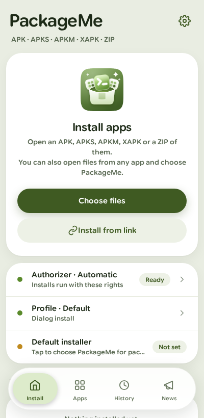
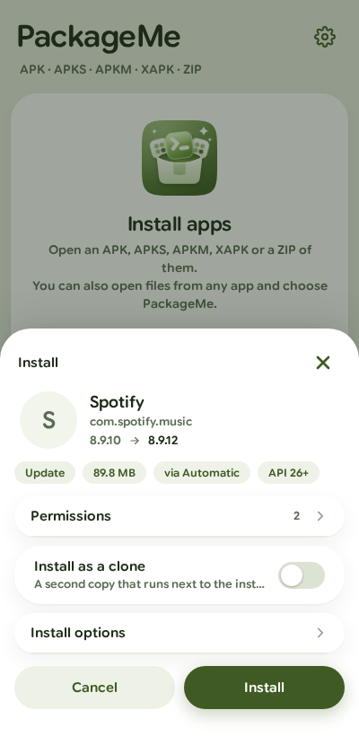
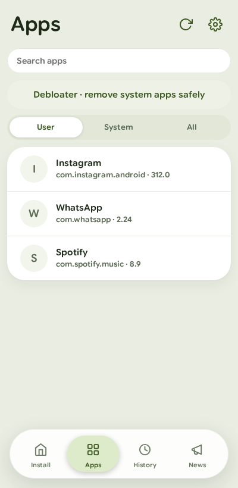
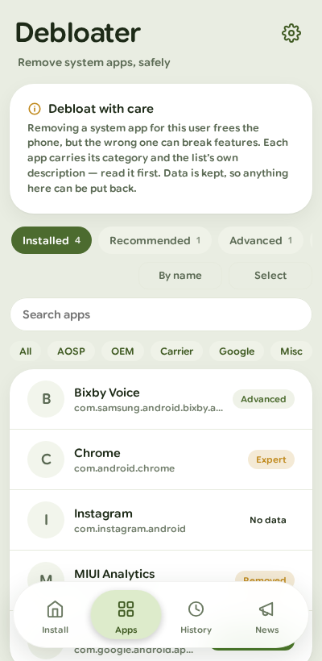
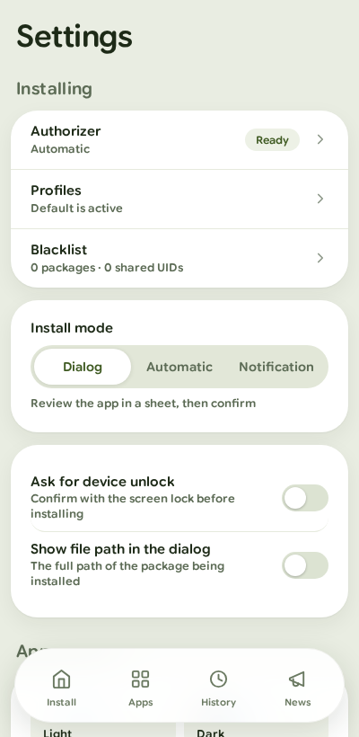
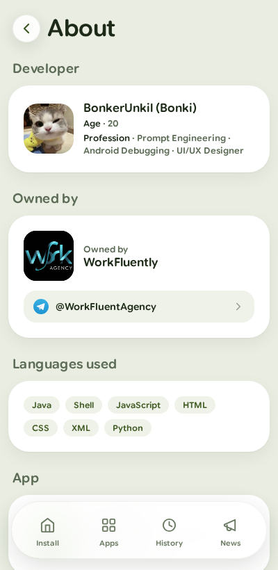

<div align="center">



# PackageMe

**APK · APKS · APKM · XAPK · ZIP — a quiet, fast package installer for Android.**

Root · Shizuku · System · Android 8+

</div>

---

## Screenshots

| Install | Install sheet | Apps |
|:--:|:--:|:--:|
|  |  |  |

| Debloater | Settings | About |
|:--:|:--:|:--:|
|  |  |  |

---

## Features

**Install**
- APK, APKS, APKM, XAPK and ZIP — split APKs and OBB are handled
- Root, Shizuku, **wireless debugging (adb)** or the system installer — no root needed for silent installs
- Install from a link, from any app, or from a file
- Signature check, downgrade, test-only and low-SDK bypass
- Silent installs in the background with a progress notification
- Screen-lock confirmation before installing
- Detects Xposed / LSPosed modules and opens LSPosed for them

**Manage**
- App list with icons, search and filters
- Open, share APK, back up APKs, permissions, signature, freeze, clear data, clone
- Install any app as a dual (clone) beside the original
- History of everything the installer did, with logs

**Debloat**
- The Universal Android Debloater list, bundled and updatable
- Categories, warnings and the list's own description per app
- Save apps, save presets, restore anything removed

**Look**
- Light, dark and pitch black, plus a Material theme
- Centre-card or bottom-sheet sheets
- Eight languages: English, हिन्दी, Español, Deutsch, 日本語, 简体中文, Türkçe, 한국어

---

## Install

1. Install `PackageMe-<version>.apk`.
2. Open **Settings → Authorizer** and pick **Root**, **Shizuku** or **System**.
3. For silent installs without root, flash `PackageMe-<version>-module.zip` in Magisk / KernelSU.

---

## Build

```bash
./build.sh          # PackageMe.apk
./build.sh module   # also PackageMe-module.zip
```

Needs JDK 17, Android build-tools 34 and platform 34. No Gradle.

---

## About

**Developer** — BonkerUnkil · Prompt Engineering, Android Debugging, UI/UX Design
**Owned by** — WorkFluently · [@WorkFluentAgency](https://t.me/WorkFluentAgency)
**Built with** — Java · Shell · JavaScript · HTML · CSS · XML · Python
**Design language** — Gitly

Built on the shoulders of **InstallerX Revived** and **InstallerX** by Rosan (GPL-3.0).
Debloat data: the Universal Android Debloater list, by the Universal-Debloater-Alliance.

---

## Licence

GPL-3.0. See [LICENSE](LICENSE).
